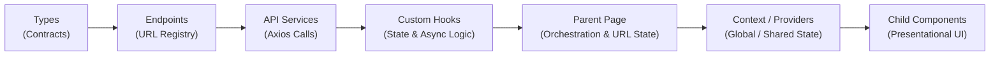

# Colosseum Web — Engineering Rules, Conventions & AI Agent Guidelines

> **Document Purpose:** Authoritative engineering standard, conventions, and operational guidelines for the frontend codebase (`project/colosseum_web`). All newly created features, pages, components, hooks, and services must strictly adhere to these rules.

---

## 1. AI Agent Operational Directive (Filtered & Adapted from Web Chat)

Unlike a stateless web chat interface where tokens are scarce and the assistant must ask the user to paste files, **you are an autonomous AI Agent operating directly inside the project with full workspace access**.

### What Was Filtered Out & Adapted:

- ❌ **Filtered Out:** _"Ask the user for files before taking action."_ (The user does not need to waste time pasting code).
- ✅ **Adapted Rule (Autonomous File-First Discovery):**
  1. **Direct Workspace Inspection:** You have built-in tools (`view_file`, `run_command`, `grep`). Always inspect existing files, `package.json`, `index.css`, and types autonomously before writing or modifying code.
  2. **Context Before Action:** Never modify or generate code based on assumptions. Verify directory trees and actual imports directly from the filesystem.
  3. **Zero Hallucination:** Never guess component names, prop interfaces, or API contracts. Read the source file directly.
  4. **Autonomous Quality Verification:** Always execute `npm run lint` and `npm run build` via terminal commands to verify 0 errors before reporting completion.

---

## 2. Architecture & Unidirectional Data Flow

The codebase strictly enforces a **unidirectional, layered separation of concerns**:



```
types/  ──▶  utils/endPoints.ts  ──▶  apis/  ──▶  hooks/  ──▶  pages/  ──▶  contexts/  ──▶  components/
```

### Layer Rules & Responsibilities:

| Layer                      | Path                           | Responsibility & Rules                                                                                                                                                                 |
| :------------------------- | :----------------------------- | :------------------------------------------------------------------------------------------------------------------------------------------------------------------------------------- |
| **1. Types**               | `@/types/`                     | Single source of truth. Divided into `@/types/api/` (DTOs, params, responses) and `@/types/components/`. Always use `import type` and `export type`.                                   |
| **2. Endpoints**           | `@/utils/endPoints.ts`         | Centralized dictionary of all backend endpoints using `as const` and parameter builder functions (e.g. `getById: (id: number) => ...`). Never hardcode raw URLs in API services.       |
| **3. API Services**        | `@/apis/`                      | Central Axios instance (`@/apis/axios.ts`) with `baseURL`, `withCredentials: true`. Domain modules (`storyApi.ts`, `landmarkApi.ts`) export typed functions returning `response.data`. |
| **4. Custom Hooks**        | `@/hooks/`                     | **All business logic, side-effects, and API calls belong here.** Manages `data`, `loading`, `error`, and `refresh`. Components **never** call Axios directly.                          |
| **5. Parent Pages**        | `@/pages/`                     | Coordinates URL query params (`useSearchParams`), dialog visibility, and hooks. Passes data and callback handlers down via props.                                                      |
| **6. Context & Providers** | `@/contexts/` & `@/providers/` | Reserved **strictly for global states** (e.g. `ToastContext`, `AuthContext`) to avoid extreme prop-drilling. Consumer hooks must throw errors if used outside provider.                |
| **7. Child Components**    | `@/components/`                | **Dumb & Presentational.** Receive data and action handlers via props. Pure UI rendering with zero direct API dependencies.                                                            |

---

## 3. Centralized Routing System

All routes are defined in a single file: `src/utils/route.tsx`, rendered in `main.tsx` via React Router's `createBrowserRouter`.

```
                    ┌──────────────────────────────┐
                    │      createBrowserRouter     │
                    └──────────────┬───────────────┘
                                   │
              ┌────────────────────┴────────────────────┐
              ▼                                         ▼
   ┌──────────────────────┐                  ┌──────────────────────┐
   │     PublicLayout     │                  │   ProtectedLayout    │
   │  (Unauthenticated)   │                  │   (Authenticated)    │
   ├──────────────────────┤                  ├──────────────────────┤
   │  • / (Landing)       │                  │  • /home             │
   │  • /auth (Sign In)   │                  │  • /search           │
   │                      │                  │  • /profile/:user    │
   │  Redirect to /home   │                  │  • /settings         │
   │  if already authed   │                  │                      │
   │                      │                  │  Redirect to /       │
   │                      │                  │  if unauthenticated  │
   └──────────┬───────────┘                  └──────────┬───────────┘
              │                                         │
              └────────────────────┬────────────────────┘
                                   ▼
                      ┌─────────────────────────┐
                      │        AppShell         │
                      │  • ToastProvider        │
                      │  • Sticky NavBar        │
                      │  • Main Content Outlet  │
                      └─────────────────────────┘
```

### Layout Guard Rules (`src/components/Layout.tsx`):

- **`AppShell`:** Base shell containing global providers (`ToastProvider`), sticky navigation slot, and `<Outlet />`.
- **`PublicLayout`:** Guards public routes. If user is authenticated, redirects to `/home` via `<Navigate to="/home" replace />`. Renders `<AppShell auth={false} />`.
- **`ProtectedLayout`:** Guards private routes. If user is unauthenticated, redirects to `/` via `<Navigate to="/" replace />`. Renders `<AppShell auth={true} />`.
- **Catch-All 404:** Every router must conclude with `{ path: '*', element: <NotFound /> }`.

---

## 4. Styling & Theme Standards

### Tailwind CSS Only

- **Zero Inline Styles:** Absolutely no `style={{ ... }}` attributes.
- **Design Tokens:** Strictly use the semantic CSS variables defined in `src/index.css`:
  - `bg-background` / `text-foreground`
  - `bg-primary` / `text-primary-foreground`
  - `bg-secondary` / `text-secondary-foreground`
  - `bg-card` / `text-card-foreground`
  - `bg-muted` / `text-muted-foreground`
  - `border-border` / `ring-ring`
- **No Hardcoded Hex/RGB:** Do not use arbitrary colors (e.g. `#ffffff` or `#121212`) directly in class names. Rely on semantic tokens to ensure automatic, seamless Light/Dark mode transitions.
- **Mobile-First Responsive Design:** Build mobile layout first, scaling up with `sm:`, `md:`, `lg:`, and `xl:`.

---

## 5. Technical Constraints & Type Safety

- **Strict TypeScript:** Every component prop, state, hook return value, and API response must have an explicit Interface or Type.
  - No `any`. Use `unknown` with type narrowing if type is undetermined.
- **Iconography:** Use standard icons from `lucide-react` (or `react-icons` Lucide subset `Lu...`).
- **Path Aliases:** Always use absolute path aliases (`@/components/...`, `@/hooks/...`, `@/apis/...`, `@/utils/...`, `@/types/...`).
- **Loading & Skeleton States:** Every asynchronous data fetch must handle loading feedback using custom pulse skeleton arrays (e.g., `{[1, 2, 3, 4].map(...)}`) and inline spinners (`animate-spin`).

---

## 6. State Synchronization (Toast & Dynamic Refetch)

- **Explicit User Feedback:** After every state-mutating action (Create, Edit, or Delete), trigger a toast notification via `useToast()` (e.g. `showSuccess('Landmark saved successfully')` or `showError(message)`).
- **Dynamic Refetching (No Page Reloads):** Never perform full browser reloads (`window.location.reload()`). Always pass an `onSuccess` callback to mutation hooks to trigger dynamic data refetching (e.g., `refresh()`), keeping the UI perfectly in sync with the database.

---

## 7. Communication & Code Quality

- **Language:** **Always explain your logic, architectural decisions, and code summaries in English.**
- **Code Quality:** Write clean, modular, production-ready, and reusable code. Avoid unnecessary bloated custom components when clean Tailwind classes achieve the exact same result.
- **Documentation Integrity:** Preserve all existing comments and docstrings unless explicitly instructed otherwise.

---

## 8. File & Folder Naming Conventions

| Category               | Convention                            | Examples                                                          |
| :--------------------- | :------------------------------------ | :---------------------------------------------------------------- |
| **Components & Pages** | PascalCase (`.tsx`)                   | `Home.tsx`, `StoryCard.tsx`, `HeroSection.tsx`                    |
| **Custom Hooks**       | camelCase starting with `use` (`.ts`) | `useFetchStories.ts`, `useSignIn.ts`, `useToast.ts`               |
| **API Services**       | camelCase with `Api` suffix (`.ts`)   | `storyApi.ts`, `authApi.ts`                                       |
| **Types & Contracts**  | camelCase with `Types` suffix (`.ts`) | `storyTypes.ts`, `authTypes.ts`, `CommonTypes.ts`                 |
| **Utilities**          | camelCase (`.ts` / `.tsx`)            | `route.tsx`, `endPoints.ts`, `localStorageUtils.ts`               |
| **Domain Folders**     | lowercase / kebab-case                | `apis/story/`, `hooks/auth/`, `types/api/`, `components/landing/` |
